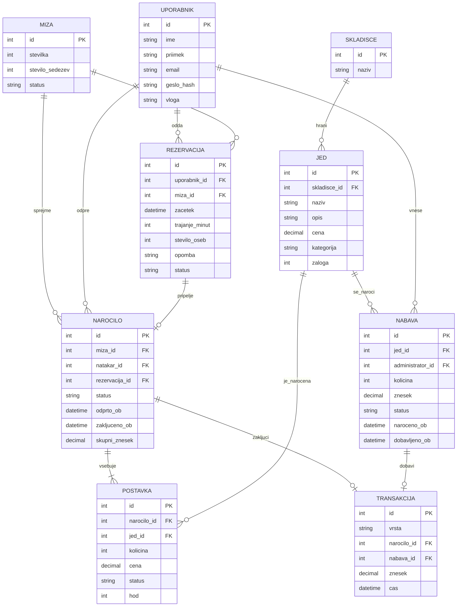

# 03. Podatkovni model

Podatki so v relacijski bazi PostgreSQL, za eno restavracijo. Vsaka funkcionalnost iz dokumenta o obsegu bere ali piše v spodnje tabele. Povezave so tuje ključe, ne posebna logika mimo baze.

Tabele so: uporabnik, miza, rezervacija, skladišče, jed, naročilo, postavka, nabava in transakcija.

## Entitete in polja

### Uporabnik

| Polje      | Opis                                           |
| ---------- | ---------------------------------------------- |
| id         | Primarni ključ                                 |
| ime        | Ime                                            |
| priimek    | Priimek                                        |
| email      | Enoličen, uporabljen za prijavo                |
| geslo_hash | Zgoščeno geslo                                 |
| vloga      | `gost`, `natakar`, `kuhar` ali `administrator` |

### Miza

| Polje           | Opis                                   |
| --------------- | -------------------------------------- |
| id              | Primarni ključ                         |
| stevilka        | Številka mize, enolična                |
| stevilo_sedezev | Število sedežev                        |
| status          | `prosta`, `rezervirana` ali `zasedena` |

### Rezervacija

| Polje          | Opis                                       |
| -------------- | ------------------------------------------ |
| id             | Primarni ključ                             |
| uporabnik_id   | Tuji ključ na gosta                        |
| miza_id        | Tuji ključ na mizo                         |
| zacetek        | Datum in ura začetka                       |
| trajanje_minut | Dolžina termina, privzeto 120              |
| stevilo_oseb   | Število oseb                               |
| opomba         | Besedilo za natakarja, lahko prazno        |
| status         | `potrjena`, `odpovedana` ali `gost_prisel` |

Dve potrjeni rezervaciji iste mize se v terminu ne smeta prekrivati. To se preveri nad vrsticami te tabele.

### Skladišče

V bazi sta dve vrstici: kuhinja in bar. Kuhar bere samo kuhinjo. Natakar vidi razpoložljivost obeh.

| Polje | Opis                          |
| ----- | ----------------------------- |
| id    | Primarni ključ                |
| naziv | `kuhinja` ali `bar`, enoličen |

### Jed

Jed je postavka jedilnika. Količina, iz katere se ob prodaji odšteva, je na isti vrstici in pripada enemu skladišču.

| Polje        | Opis                                            |
| ------------ | ----------------------------------------------- |
| id           | Primarni ključ                                  |
| skladisce_id | Tuji ključ na skladišče, kuhinja ali bar        |
| naziv        | Ime jedi ali pijače                             |
| opis         | Kratek opis, lahko prazen                       |
| cena         | Prodajna cena v evrih                           |
| kategorija   | `predjed`, `glavna_jed`, `sladica` ali `pijaca` |
| zaloga       | Količina na voljo, celo število                 |

Natakar sme postavko dodati samo, če je `zaloga` večja od nič. Ko pade na nič, na naročilo ne gre več.

### Naročilo

| Polje          | Opis                                                         |
| -------------- | ------------------------------------------------------------ |
| id             | Primarni ključ                                               |
| miza_id        | Tuji ključ na mizo                                           |
| natakar_id     | Tuji ključ na natakarja                                      |
| rezervacija_id | Tuji ključ na rezervacijo, prazen pri gostu brez rezervacije |
| status         | `odprto` ali `zakljuceno`                                    |
| odprto_ob      | Čas odprtja                                                  |
| zakljuceno_ob  | Čas zaključka, prazen dokler je naročilo odprto              |
| skupni_znesek  | Seštevek postavk, izpolnjen ob zaključku                     |

Na mizi je naenkrat največ eno odprto naročilo.

### Postavka naročila

| Polje       | Opis                                    |
| ----------- | --------------------------------------- |
| id          | Primarni ključ                          |
| narocilo_id | Tuji ključ na naročilo                  |
| jed_id      | Tuji ključ na jed                       |
| kolicina    | Število kosov                           |
| cena        | Prodajna cena kosa v trenutku naročila  |
| status      | `caka`, `pripravljena` ali `postrezena` |
| hod         | Zaporedje postrežbe: `1`, `2` ali `3`. Prazno pri pijači |

Cena ostane na postavki, da kasnejša sprememba cene v jedilniku ne spremeni računa. Kuhinjski zaslon bere postavke odprtih naročil, katerih jed pripada skladišču kuhinja in katerih hod je trenutno odprt. Hod je odprt, ko so vsi nižji hodi istega naročila že postreženi. Pijača nima hoda in v kuhinjo ne gre.

Prenos naročila na drugo mizo spremeni samo `narocilo.miza_id`. Postavke, hodi in statusi ostanejo. Stara miza dobi status `prosta`, nova `zasedena`.

### Nabava

Ena vrstica je naročilo ene jedi ali ene pijače. Dobava ni nova tabela: ista vrstica dobi status `dobavljeno` in čas dobave. Tako naročilo in dobava ostaneta v tej tabeli.

| Polje            | Opis                                        |
| ---------------- | ------------------------------------------- |
| id               | Primarni ključ                              |
| jed_id           | Tuji ključ na jed, ki se naroča             |
| administrator_id | Tuji ključ na administratorja               |
| kolicina         | Naročena količina                           |
| znesek           | Nabavni znesek te vrstice                   |
| status           | `naroceno` ali `dobavljeno`                 |
| naroceno_ob      | Čas naročila                                |
| dobavljeno_ob    | Čas dobave, prazen dokler blago ni prispelo |

Ob prehodu v `dobavljeno` se `kolicina` prišteje k `jed.zaloga`. Skladišče je tisto, na katerega kaže jed.

### Transakcija

Ob zaključku naročila se zapiše ena transakcija vrste `prodaja`. Ob dobavi se zapiše ena transakcija vrste `nabava`. Zaključenih transakcij se ne briše.

| Polje       | Opis                                          |
| ----------- | --------------------------------------------- |
| id          | Primarni ključ                                |
| vrsta       | `prodaja` ali `nabava`                        |
| narocilo_id | Tuji ključ na naročilo, izpolnjen pri prodaji |
| nabava_id   | Tuji ključ na nabavo, izpolnjen pri dobavi    |
| znesek      | Znesek te transakcije                         |
| cas         | Čas zapisa                                    |

Miza, natakar in postavke prodaje se preberejo prek `narocilo_id`. Dobava se prebere prek `nabava_id`. V pregledu ostaneta ločeni po polju `vrsta`.

Prihodki za teden, mesec ali leto so vsota `znesek` pri vrsti `prodaja` v tem obdobju. Znesek nabave je vsota pri vrsti `nabava`. Obdobje se izbere ob branju, zato posebne tabele obračuna ni: obračun je vedno seštevek shranjenih transakcij.

## Povezave

- En gost ima več rezervacij. Rezervacija pripada enemu gostu.
- Ena miza ima več rezervacij in več naročil. Rezervacija in naročilo pripadata eni mizi.
- En natakar odpre več naročil.
- Rezervacija ima največ eno naročilo. Naročilo je lahko brez rezervacije.
- Eno skladišče ima več jedi. Jed pripada enemu skladišču.
- Eno naročilo ima več postavk. Postavka pripada enemu naročilu in eni jedi.
- Ena jed je v več postavkah in v več vrsticah nabave.
- En administrator vnese več vrstic nabave.
- Zaključeno naročilo ima eno transakcijo vrste `prodaja`.
- Dobavljena nabava ima eno transakcijo vrste `nabava`.

## Osnutek podatkovnega modela

