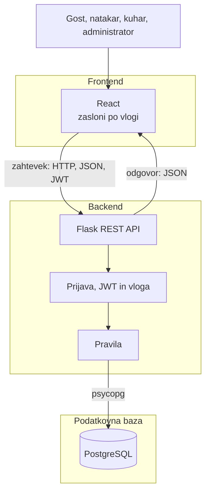

# 04. Arhitektura in tehnološki sklad

## Arhitektura

### Glavni deli

1. **React.** Spletni vmesnik za gosta, natakarja, kuharja in administratorja. Pokaže samo tisto, kar vloga sme videti.
2. **Flask REST API.** Prijava, vloge in pravila. Bere in piše v bazo.
3. **PostgreSQL.** Shramba podatkov.

### Komunikacija

React pošilja HTTP zahtevke s telesom JSON. Zaščitene poti zahtevajo glavo `Authorization` z JWT žetonom. API odgovori z JSON.

### Podatkovna baza

PostgreSQL teče lokalno. Shema je devet povezanih tabel iz podatkovnega modela. Do baze dostopa samo API, prek SQLAlchemy.

### Avtentikacija

Gost se registrira sam. Račune natakarja in kuharja ustvari administrator. Ob prijavi API preveri e-pošto in geslo ter vrne JWT z identifikatorjem in vlogo. Geslo je v bazi samo zgoščeno. Vsaka pot preveri vlogo.

### Lokalni zagon

V virtualnem okolju se API zažene z `flask run`, React z `npm start`. PostgreSQL teče lokalno, baza se imenuje `glass`. V `.env` sta `DATABASE_URL` in `JWT_SECRET`.

### Diagram

## Tehnološki sklad

| Del             | Tehnologija                                               |
| --------------- | --------------------------------------------------------- |
| Frontend        | React                                                     |
| Backend         | Python, Flask, Flask-SQLAlchemy                           |
| Podatkovna baza | PostgreSQL, gonilnik psycopg                              |
| Avtentikacija   | Flask-JWT-Extended, zgoščevanje gesel z Werkzeug          |
| Lokalni razvoj  | Git, virtualno okolje Python, lokalni PostgreSQL, Node.js |
| Drugi deli      | Python skripte             |

## Arhitekturne odločitve

**React in Flask sta ločena.** Zasloni so v Reactu, pravila in podatki v API-ju. Isti API uporabljajo vse štiri vloge.

**PostgreSQL.** Rezervacije, naročila, zaloga, nabava in transakcije so povezane. Tuji ključi držijo te povezave skupaj.

**JWT.** Ena prijava zadošča za vse vloge. Vloga v žetonu določa, kateri klici so dovoljeni.