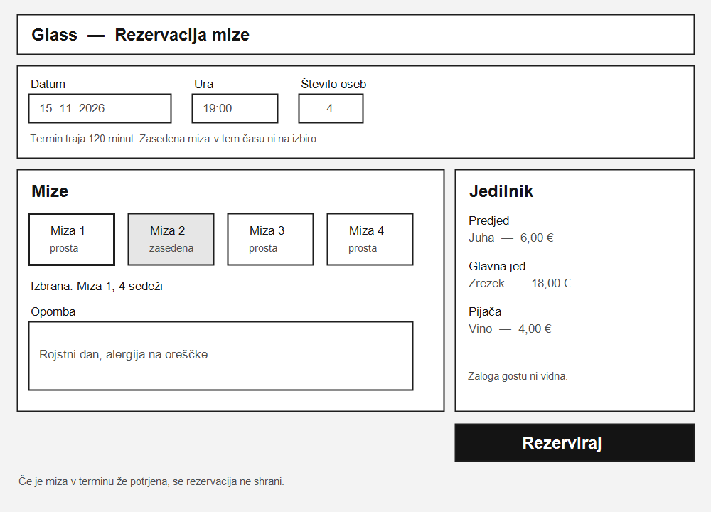
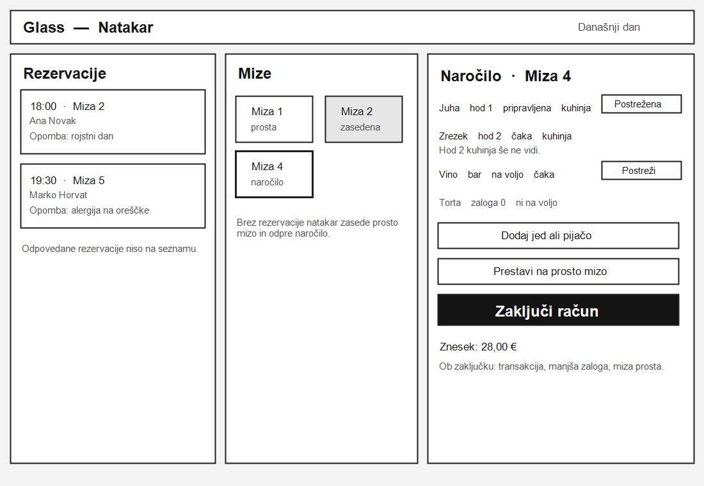
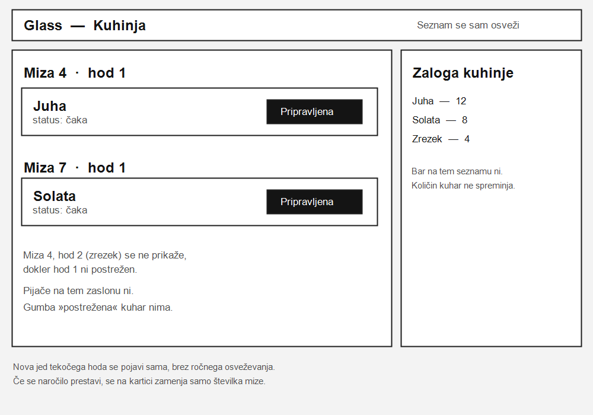

# 06. Wireframi

Trije zasloni pokažejo osnovni potek iz naloge 1: gost rezervira mizo, natakar vodi naročilo, kuhinja pripravlja tekoči hod. Narisani so kot žični modeli, brez barv in končnega videza.

## Rezervacija mize

Zaslon gosta pred obiskom. Gost izbere datum, uro, število oseb in prosto mizo, doda opombo in odda rezervacijo. Ob obrazcu vidi jedilnik po kategorijah, brez zaloge. Miza, ki je v terminu zasedena, ni izbirna.

## Natakar

Zaslon med izmeno. Levo so današnje rezervacije z opombo. Na sredini so mize. Desno je odprto naročilo izbrane mize: hod, status jedi, pijača iz bara in jed, ki je ni na zalogi. Natakar lahko jed postreže, naročilo prestavi na prosto mizo ali zaključi račun.

## Kuhinja

Zaslon v kuhinji. Jedi odprtih naročil so po mizah, viden je samo tekoči hod. Kuhar jed označi kot pripravljeno. Naslednji hod, pijača in gumb za postrežbo na zaslonu niso. Ob strani je zaloga kuhinje, brez bara.

